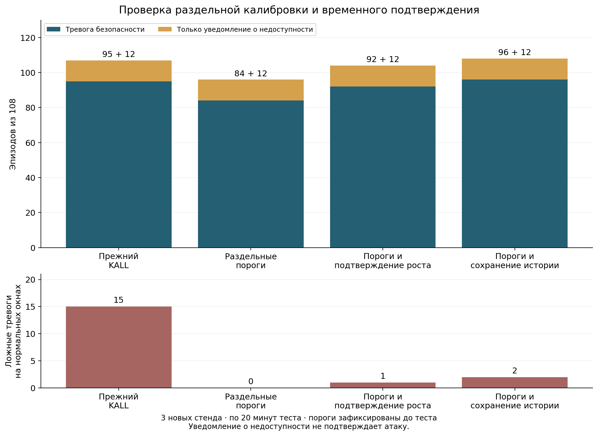

# Подтверждённая проверка счётчиков ошибок и сохранения истории нагрузки

9 ноября 2026 года завершена новая независимая серия на трёх стендах Open5GS.
Вариант CARRY дал тревогу безопасности в 96/108 эпизодов и два ложных решения
на 27 720 нормальных окнах. На тех же данных прежний KALL дал 95/108 и 15
ложных решений. CARRY обнаружил все 12 эпизодов S4 и все 12 эпизодов роста G,
включая четыре пересечения с разрешением оператора.

Остальные 12 эпизодов — подавление доставки D — вызвали только уведомление
о недоступности. Поэтому 108/108 относится к операционному покрытию,
а не к подтверждённому обнаружению всех атак. Сохраняются два ложных окна,
задержки обнаружения и периоды без достоверного контроля.



## Методика и происхождение изменений

[Запуск 42577623990](https://github.com/verge88/signal_network_sim/actions/runs/42577623990)
завершился успешно во всех трёх заданиях. Измеренный код:
`bd054ce152bb4241c5504503056f5261916a884b`.
[Протокол](PROTOCOL_RU.md) опубликован до измерений. Seeds: 33101, 33201,
33301; фазовые seeds +0/+10/+20. На каждом стенде 8 логических NF-позиций,
600 нормальных окон обучения, 600 независимой нормальной калибровки и
1200 тестовых окон с периодом 1 с. Всего 14 400 обучающих, 14 400
калибровочных и 28 800 тестовых NF-окон. В тесте 108 десятиоконных эпизодов,
1080 атакующих и 27 720 нормальных окон.

Первая попытка раздельной калибровки сохранена в
[отдельном отчёте](../calibrated_5g/README.md). Она выявила потерю точности
чтения CSV и ложные тревоги на единичных разрешённых ошибках 404 при малом
числе запросов. Её CI-аудит завершился ошибкой; последующий точный пересчёт
воспроизвёл исходные решения, включая ложные тревоги. Эти результаты
использованы для разработки и не смешаны с новой подтверждающей серией.

В новой версии введены отдельные пороги количества запросов, количества
ошибочных запросов и числа обновлений. Число ошибок восстанавливается как
round(request_count × error_rate) из реально измеренных счётчиков. Это новый
способ представления прежних наблюдений, не дополнительная разметка.
Чтение дробных значений калибровки и аудита сохраняет исходную точность float.

Временной вариант PERSIST использует минимум текущего P и двух предыдущих
значений P той же NF. CARRY сохраняет историю роста во время действия
подлинного разрешения; само разрешение подавляет текущую тревогу, а после
его окончания накопленная история снова участвует в решении. CARRY и PERSIST
проверяются отдельно, не объединяются после просмотра результатов.

Для каждого статистического компонента новой версии alpha=0,001/4; порог —
порядковая статистика ceil((n+1)*(1-alpha)). При 4800 калибровочных NF-окнах
это максимум. Превышение строгое. Полученные до теста пороги на всех стендах:
37 запросов, 1 ошибочный запрос, 1 обновление; PERSIST — 0; CARRY — 2, 2, 1.
Семантические проверки, независимый контроль, повторы и доступность сохранены.
Распределение номинального бюджета ошибки не доказывает эксплуатационный FPR:
наблюдения зависимы, обменность не установлена.

## Сравнение на одних новых данных

| Вариант | Эпизоды с тревогой безопасности /108 | Эпизоды с любым уведомлением /108 | Атакующие окна с тревогой /1080 | Ложные тревоги /27720 нормальных окон |
|---|---:|---:|---:|---:|
| PREVIOUS: прежний KALL, калиброванный на той же новой норме | 95 | 107 | 855 | 15 |
| SPLIT: отдельные пороги без временного дополнения | 84 | 96 | 804 | 0 |
| PERSIST: отдельные пороги и подтверждение роста в трёх окнах | 92 | 104 | 838 | 1 |
| CARRY: отдельные пороги и сохранение истории через разрешение | 96 | 108 | 865 | 2 |

Для CARRY: полнота тревог безопасности по эпизодам 88,89%, по атакующим окнам
80,09%, FPR по нормальным окнам 0,007215%. Совместное операционное покрытие —
108/108 эпизодов и 944/1080 атакующих окон. Нормальная экспозиция составляет
7,7 эквивалентных NF-часа односекундных выборок; два ложных окна соответствуют
0,260 на такой NF-час. Это выборочная оценка стенда, не характеристика
непрерывного операторского контроля.

| Семейство | PREVIOUS: эпизоды с тревогой | PERSIST: эпизоды с тревогой | CARRY: эпизоды с тревогой |
|---|---:|---:|---:|
| S1 | 12/12 | 12/12 | 12/12 |
| S2 | 12/12 | 12/12 | 12/12 |
| S3 | 12/12 | 12/12 | 12/12 |
| S4 | 12/12 | 12/12 | 12/12 |
| C: изменение конфигурации | 12/12 | 12/12 | 12/12 |
| F: подделка отчёта | 12/12 | 12/12 | 12/12 |
| R: повтор отчёта | 12/12 | 12/12 | 12/12 |
| D: подавление доставки | 0/12 | 0/12 | 0/12 |
| G: рост нагрузки | 11/12 | 8/12 | 12/12 |

Во всех вариантах все D вызывают отдельное уведомление о недоступности.
SPLIT без временного признака пропускает все G. В этой серии прежний метод
тоже выявил все S4, поэтому нельзя объявлять новый результат причинным
улучшением 8→12 на одинаковых данных. Раздельные пороги устраняют известный
механизм маскирования доли ошибок всплесками количества запросов; новая
серия подтверждает работоспособность представления через число ошибок.

PERSIST уменьшил ложные тревоги, но потерял четыре G, пересекающихся с
разрешением. Усиление подтверждения не дало однозначного улучшения.
CARRY дал наиболее полное покрытие среди заранее определённых вариантов
в этой серии; это результат сравнения, не универсальный выбор лучшего метода.

## Пересечения с разрешениями и оставшиеся ложные тревоги

Четыре G имели по пять разрешённых окон: test-33121-G-785,
test-33121-G-905, test-33221-G-425, test-33321-G-425. PERSIST пропустил их все.
CARRY заметил продолжение роста после окончания разрешения примерно через
5,03–6,11 с от начала воздействия. Прежний KALL пропустил
test-33221-G-425 с шагом роста 1 запрос за окно; CARRY его обнаружил.

Это не доказывает различимость атаки и законной активности, полностью
укладывающихся в действующее разрешение. В проверенных случаях наблюдалось
продолжение роста после окончания разрешения. Полностью скрытая внутри
разрешённого интервала активность остаётся ограничением модели наблюдений.

Два ложных окна CARRY относятся к одной непрерывной ситуации: seed 33301,
slot-6, окна 539–540. Обычный ряд 2,3,4,5,6,7 запросов продолжился разрешённым
случайным всплеском до 26. Оценки CARRY 2 и 3 превысили порог 1. PERSIST
сработал только в окне 540. В обоих окнах отдельные статистические пороги
не превышены; причина — временная последовательность, не счётчик ошибок.
Все эти наблюдения сохранены в [диагностике](results/diagnostics.json).

## Доступность и задержки

Контроль конфигурации относится к slot-4: 3120 нормальных и 480 атакующих
окон. Во всех новых вариантах нет ложных тревог безопасности на норме этой
NF. Однако 51 нормальное окно (1,63%) имеет уведомление о недоступности,
ещё 213 (6,83%) остаются unknown. Перевод отсутствия отчёта в уведомление
не восстанавливает достоверное знание состояния NF.

51 окно образует 22 непрерывных нормальных отрезка: 12 при запланированных
штатных остановках наблюдателя и 10 продолжений недоступности после
атакующих интервалов. Это не 22 независимых штатных отказа. На атаке
slot-4 остаются 77 окон unknown. Для CARRY суммарно 53 нормальных окна имеют
какое-либо уведомление: 51 о недоступности и 2 ложные тревоги безопасности.

Задержки CARRY среди обнаруженных эпизодов, медиана / 95-й перцентиль:

| Сценарий | Время |
|---|---:|
| S4 | 75,47 / 80,06 мс |
| R | 62,50 / 80,68 мс |
| G | 5,038 / 6,081 с |
| D, до уведомления о недоступности | 6,045 / 6,081 с |

Общая медиана тревог CARRY — 67,03 мс, p95 — 5,048 с. Она не описывает
реакцию на медленный рост. Воздействия привязаны к циклу наблюдения;
произвольная фаза начала атаки не проверялась. Таймер доступности вычисляется
при очередном наблюдении и не является независимым сторожевым процессом
на случай остановки самого сборщика.

За тест 1200,10–1200,17 с сборщик использовал 40,81–81,97 процессорных секунд,
около 3,40–6,83% одного ядра; пик памяти 188,95–189,44 МиБ. Медианы контрольной
транзакции по стендам 0,503–0,890 мс, p95 0,647–1,060 мс. Редкие задержки
0,35 с сохранены, но не попадают в p95. Все варианты вычислялись совместно;
расходы отдельных NF/Open5GS не включены, причинная добавочная стоимость
каждого дополнения и задержки UE не установлены.

## Проверки, воспроизведение и границы вывода

На каждом runner прошли 37 программных тестов. Независимый аудит прошёл
в CI и повторно локально для всех трёх архивов: проверены полные сетки окон,
разделение фаз, нормальный состав обучения/калибровки, замораживание до теста,
модели и хеши, фактическое применение воздействий, старые и новые решения.
Несовпадений при воспроизведении нет. SHA-256 всех ZIP совпадает с GitHub.
После теста добавлены только сводки, диагностика, графики и этот отчёт.
Измеренные детекторы, пороги и решения не менялись.

Полные архивы сохранены локально в `research_5g/calibrated_v2_20261109`;
в Actions срок хранения 30 дней, до 9 декабря 2026 года. В Git постоянно
сохранены сводки, аудит, диагностика, контрольные суммы и графики. PCAP не
собирался; доступны HTTP-транзакции, отчёты, разрешения, признаки, разметка,
модели, решения, журналы и снимки служб. Лабораторные ключи одноразовые.

Использованы настоящий NRF Open5GS, штатная NSSF и программные NF-участники.
Независимое чтение реально применённой конфигурации относится к исследовательской
NF, зарегистрированной в NRF, а не к внутренней памяти штатных NF. ОС,
наблюдатель, ключи и управление разрешениями доверенные. Подмена/подавление
отчётов вводились в локальный IPC, сетевой взлом не воспроизводился.
Радиодоступ, UE/PDU и аппаратная аттестация не проверялись. Коррелированные
окна и три стенда не устанавливают переносимость на трафик оператора.

- [Сводка и все эпизоды](results/summary.json)
- [Диагностика ложных тревог и пересечений](results/diagnostics.json)
- [Контрольные суммы архивов](results/archive_integrity.json)
- [PDF](results/comparison.pdf), [SVG](results/comparison.svg)

После распаковки трёх архивов в одноимённые каталоги:

```bash
python -m experiments.calibrated_5g_v2.audit /data/calibrated-v2-5g-33101-42577623990
python -m experiments.calibrated_5g_v2.audit /data/calibrated-v2-5g-33201-42577623990
python -m experiments.calibrated_5g_v2.audit /data/calibrated-v2-5g-33301-42577623990
python experiments/calibrated_5g_v2/summarize.py /data /results
python -m experiments.calibrated_5g_v2.diagnose /data /results
python experiments/calibrated_5g_v2/plot_results.py /results
```

Зависимости — `experiments/live_5g/requirements.txt`, для графика дополнительно
matplotlib. Workflow нового сбора — `.github/workflows/calibrated-5g-v2.yml`.
