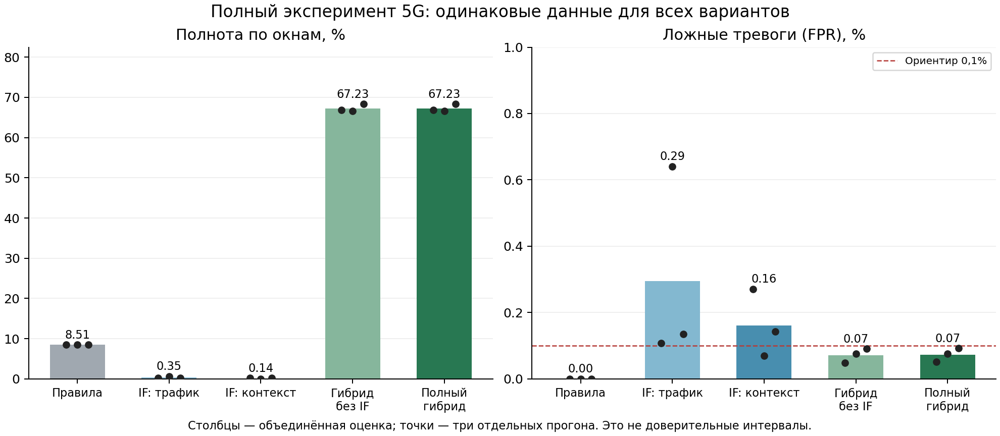

# Полный эксперимент реализованного метода 5G с Data Mining

Серия завершена 12 ноября 2026 года по местному времени. Все три задания
[GitHub Actions 43070045549](https://github.com/verge88/signal_network_sim/actions/runs/43070045549)
успешны. Код эксперимента: `3d5ff6fda05b8881e143246026be1b454625c24d`.
[Протокол](../../FULL_PROTOCOL_RU.md) зафиксирован до тестовых измерений.

Подтверждена работа всей реализованной цепочки: живые события Open5GS → признаки
→ заново обученные Isolation Forest → ведомые детекторы → зональные ведущие →
координатор → оценка на отдельных новых данных. Положительный вклад IF в
полноту гибрида в этой серии не подтверждён: он добавил ноль TP и шесть FP.
Это отрицательный результат абляции, а не основание исключать ветвь из отчёта.

## Дизайн и объём

Три независимых стенда Open5GS 2.7.6, seeds 89501, 89502, 89503. Каждый содержит
32 логические NF, 32 ведомых детектора, четыре зональных ведущих и координатор.
37 процессов иерархии размещены в пяти сетевых пространствах имён на одном
физическом runner. Один NF — штатный NSSF, остальные — зарегистрированные
исследовательские клиенты. NRF и NSSF работают реально.

В каждом прогоне собраны отдельные 600 нормальных окон обучения и 600 нормальных
окон калибровки — по 19200 наблюдений. IF обучен заново (256 деревьев), пороги
выбраны при alpha=0.001 до теста. Контрольные параметры и зональные пороги
сохранены из подготовительного этапа. Затем выполнены 3600 новых тестовых окон.
Суммарно: 57600 train, 57600 cal, **345600 test** наблюдений, из них
**1410 положительных и 344190 нормальных**, **108 эпизодов**. Тесты заняли
3617–3728 секунд каждый. Модели и пороги после начала теста не изменялись.

IF вычисляется сборщиком, который передаёт его флаг ведомым. Проверки,
накопление и принятие решения распределены. Это не распределённое обучение IF.

## Сопоставление на одинаковых данных

Эпизод засчитывается при новой тревоге внутри его интервала. Полнота окон и
полнота эпизодов имеют разные знаменатели. Неопределённость и потеря контроля
не превращаются автоматически в обнаружение нарушения безопасности.

| Вариант | TP / 1410 | FP / 344190 | Полнота окон | FPR | Precision | Новая тревога в эпизодах |
|---|---:|---:|---:|---:|---:|---:|
| Правила NFProfile/heartbeat | 120 | 0 | 8,51% | 0% | 100% | 12/108 |
| IF по SBI | 5 | 1015 | 0,35% | 0,2949% | 0,49% | 5/108 |
| IF с контекстом | 2 | 555 | 0,14% | 0,1612% | 0,36% | 2/108 |
| Гибрид без IF | 948 | 246 | 67,23% | 0,0715% | 79,40% | 87/108 |
| Прежний гибрид без сброса после нормализации | 954 | 1641 | 67,66% | 0,4768% | 36,76% | 87/108 |
| Полный гибрид со сбросом и IF | **948** | **252** | **67,23%** | **0,0732%** | **79,00%** | **87/108 (80,56%)** |

Базовые правила намеренно сохранены из протокола: они не равны всему набору
локальных проверок гибрида. Поэтому для изоляции вклада IF используется именно
пара «гибрид без IF / полный гибрид» с одинаковыми остальными компонентами.

Полнота полного гибрида по трём прогонам: 66,81%, 66,60%, 68,30%; FPR:
0,0514%, 0,0758%, 0,0924%. Во всех трёх обнаружено по 29/36 эпизодов.
Ориентир 90% не достигнут ни по окнам, ни по эпизодам.

Сброс после трёх нормальных окон уменьшил FP с 1641 до 252 (на 84,64%),
но потерял шесть TP. Совпадение общего числа новых обнаружений 87/108 не
означает совпадение всех эпизодов: в seed 89501 потеряна новая тревога в
прерывистом G, а в seed 89503 появилась новая тревога в F, где прежняя тревога
уже была активна до начала воздействия.

Для IF рассчитан average precision по непрерывным anomaly margins: SBI —
0,00833 / 0,00722 / 0,00699; контекст — 0,00833 / 0,00765 / 0,00704.
Это AP, а не трапецеидальная площадь PR-кривой. У конечного решения гибрида
нет заранее определённой непрерывной шкалы; PR-AUC для него не заявляется.
AP базовых правил в JSON использует бинарную шкалу, хотя общее поле `ap_note`
в отчёте CI названо «Continuous anomaly margin»; для правил эта подпись неточна.
Она не влияет на решения или значения метрик. Оценки трёх разных IF не
объединяются в одну PR-кривую с предположением одинакового масштаба scores.

## Обнаружение и оставшиеся пропуски

| Воздействие | Эпизоды с новой тревогой | Обнаруженные окна |
|---|---:|---:|
| S1: изменение профиля NSSF в NRF | 12/12 | 120/120 |
| S2: запрещённая лабораторной политикой операция | 12/12 | 120/120 |
| S3: изменение маршрута исследовательского потребителя | 12/12 | 120/120 |
| S4: всплеск запросов с ошибками | 12/12 | 120/120 |
| C: изменение фактической конфигурации | 12/12 | 120/120 |
| F: изменение конфигурации и подделка отчёта | 12/12 | 120/120 |
| R: повтор прежнего отчёта | 12/12 | 120/120 |
| D: подавление отчёта при изменении конфигурации | 0/12 | 0/120 |
| G: медленный рост | 3/3 | 108/180 |
| G: быстрый рост | 0/3 | 0/30 |
| G: прерывистый рост | 0/3 | 0/180 |
| G: рост внутри действующего разрешения | 0/3 | 0/60 |

Все 21 пропущенный эпизод сохранены. В D все 120 окон отмечены unknown,
57 также получили признак недоступности контроля. Это позволяет сообщить о
потере контроля, но не доказывает обнаружение скрытого изменения конфигурации.
Повтор R может иметь одновременно security и unknown: повтор доказан, а
актуальное состояние конфигурации остаётся неизвестным.

Медианная задержка новой тревоги полного гибрида — 0,438 с, максимальная —
28,466 с **среди обнаруженных эпизодов**. Пропускам не присваивается нулевая
задержка. Накопление замедляет обнаружение медленного роста; медиана не
описывает это семейство отдельно. Полная таблица задержек — [episodes.csv](episodes.csv).

## Ложные тревоги при смене режима

Общий ориентир FPR ≤0,1% выполнен в каждом прогоне, но не в каждом режиме.

| Нормальная нагрузка | FP / нормальные окна | FPR полного гибрида |
|---|---:|---:|
| Исходная | 2/86000 | 0,0023% |
| Повышенная | 142/86080 | **0,1650%** |
| Циклическая | 2/86030 | 0,0023% |
| Всплески и восстановление | 106/86080 | **0,1231%** |

Общий низкий FPR нельзя выдавать за гарантию для каждого режима. Новое обучение
IF использовало нормальный фон своего протокола, тест дополнительно включал
смену распределения нагрузки. Причины слабого IF требуют отдельного исследования;
пороги по этим тестовым данным не подбирались.

## Проверка воспроизводимости и работа иерархии

Во всех трёх CI выполнен аудит; локально полностью повторены все три аудита.
Проверены SHA-256 шести скачанных архивов, полнота сетки 345600 тестовых
наблюдений, реальные числа запросов/ошибок/задержки из HTTP-транзакций,
непересечение train/cal/test, все онлайн-решения IF и арифметика зональных
накопителей и сброса. Метки проверены по зафиксированному плану после исполнения
детекторов. Локально повторное обучение воспроизвело пороги; решения повторно
обученных моделей дополнительно сопоставлены на 1024 наблюдениях каждого прогона.
Исходные train/cal файлы проверены по хешам манифестов моделей.

Все 10800 результатов координатора полны. В seed 89503 зафиксированы **439
BrokenPipeError** при отправке ответа клиенту, закрывшему соединение. Эти
ошибки не привели к отсутствующим итоговым решениям, но показывают проблему
транспорта под нагрузкой; журналы сохранены. В двух других прогонах таких
ошибок в журналах детекторов нет. Регрессионные проверки: 32 теста локально
и в каждом CI, дополнительно 12 локальных тестов контрольного протокола.

Медиана обработки окна иерархией — 0,107–0,240 с, p95 — 0,620–0,925 с.
Суммарный CPU 37 процессов — 603–678 CPU-секунд за прогон; выборочный максимум
суммарного RSS — 844–852 МБ. CPU сборщика — 942–1084 CPU-секунды. Это измеренные
затраты компонентов, не причинная добавленная задержка относительно monitor-off.
RSS измерялся периодически, поэтому не объявляется непрерывным пиковым значением.

## Что можно заключить

Совместное выполнение реализованных компонентов подтверждено. Полный гибрид
полезнее заданных одиночных базовых вариантов на этом стенде, однако его
преимущество над идентичным гибридом без IF отсутствует. Эти данные **нельзя
использовать как доказательство дополнительной эффективности Data Mining**.
Подтверждены работа контрольных проверок, накопления и восстановления, а также
их ограничения. Следующий исследовательский вопрос — почему IF почти не
обнаруживает воздействия и как улучшить его на новой разработческой выборке,
с последующей отдельной проверкой на ещё одном нетронутом тесте.

Границы: программное свидетельство и HMAC вместо аппаратной аттестации;
нет UE/RAN/PDU-трафика, эксплуатации CVE в AUSF, физически разнесённых машин,
автоматического выбора ведущего или проверки всех возможных атак 5G.
Три независимых запуска не равны 345600 независимым экспериментам. Новые
данные используют заданные семейства воздействий, а не неизвестные семейства.

Полные числа и происхождение: [summary.json](summary.json),
[validation.json](validation.json), [scenario_states.csv](scenario_states.csv),
[normal_regimes.csv](normal_regimes.csv). График: [PDF](ablation.pdf), [SVG](ablation.svg).
Исходные архивы скачаны локально; в GitHub Actions установлен срок хранения 30 дней.
