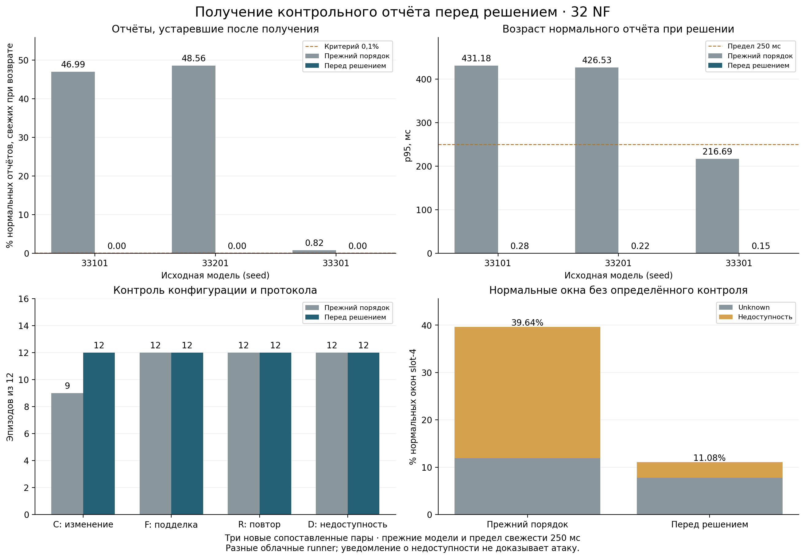

# Получение контрольного отчёта непосредственно перед решением

Предварительно заданные критерии для исправленного порядка выполнены во всех трёх прогонах. При прежнем порядке после возврата контрольного вызова устарели 2945 из 9168 нормальных свежих отчётов (32.1226%). При запросе непосредственно перед решением — 0 из 9168 (0.0000%). Предел свежести 250 мс сохранён.

[Запуск 42771575096](https://github.com/verge88/signal_network_sim/actions/runs/42771575096) · измеренный код `5e5767ea52a54743e1458eb270336754cf3dd2b6` · [предварительный протокол](PROTOCOL_RU.md). Исправленный аудит: [42779123046](https://github.com/verge88/signal_network_sim/actions/runs/42779123046), commit `4a1a46a407732953f8a42532d24d931968c8cf60`.

## Изменение и независимая проверка

Ранее контрольный отчёт запрашивался при обработке slot-4, затем ждал остальные NF и пакетный расчёт оценок. Теперь в режиме late он запрашивается после этой работы, непосредственно перед проверкой slot-4. В обоих режимах остаётся один запрос на окно. Время решения читается после получения и записи отчёта; подписанная метка не изменяется. Правила проверки подписи, nonce, сессии, последовательности и доступности сохранены.

Шесть новых часовых прогонов: три ранних early и три поздних late, каждый на 32 логических NF-позициях. Для каждой пары одинаковые новые seeds 54133, 54233, 54333 и одинаковая прежняя модель из серии 42577623990. Использованы прежние SHA-256 моделей; обучения и изменения порогов нет. Четыре фоновых режима и все 36 эпизодов на прогон сохранены. Всего 691200 NF-окон и 216 эпизодов; на режим 345600 NF-окон, 1410 атакующих окон и 344190 нормальных.

Все 45 исходных программных тестов прошли локально и в каждом из шести заданий измерений. Часовые измерения завершились, базовый независимый аудит воспроизвёл решения, но дополнительный аудит остановился с TypeError: pandas автоматически превратил decision_time из числа секунд в Timestamp. Поэтому исходный workflow имеет статус failure, и этот факт сохраняется. Чтение исправлено на сохранение исходных числовых значений JSON, добавлен регрессионный тест; хеш нагрузки канонизирован с LF для переноса между Linux и Windows. Данные, детекторы, пороги и измерения не изменены. Отдельный повторный аудит 42779123046 использовал те же шесть архивов, выполнил по 46 тестов и успешно завершился во всех заданиях. Все архивы проверены локально по SHA-256; полный локальный пересчёт совпал с исправленным аудитом CI.

Совпадение реализованных счётчиков и семантических входов между режимами подтверждено в 3/3 пар по хешам. Сравнение значений по ячейкам дало 0 различий. Временные метки и задержки в этот хеш не входят. Стенды работают на разных облачных runner: одинаковая нагрузка не означает одинаковое оборудование.

## Первичный показатель по каждой модели

Отчёт относится к нормальным по метке нормального окна slot-4. Знаменатель ниже включает только отчёты, свежие при возврате контрольного вызова. Первичный критерий late — не более 0,1% последующих истечений срока в каждом прогоне. Это показатель свежести, отличный от FPR; достижение одного не означает достижение другого.

| Source seed | Early: устарели / свежие при возврате | Late: устарели / свежие при возврате | Early p95 возраста, мс | Late p95 возраста, мс |
|---|---:|---:|---:|---:|
| 33101 | 1436/3056 | 0/3056 | 431.184 | 0.284 |
| 33201 | 1484/3056 | 0/3056 | 426.529 | 0.222 |
| 33301 | 25/3056 | 0/3056 | 216.690 | 0.154 |

Дополнительная диагностика после основного анализа проверяет возраст и к концу вычисления решения. Она не заменяет предварительный критерий:

- early: 2946 нормальных отчётов, свежих при возврате, истекли к концу решения; максимальная длительность вычисления решения 0.470 мс.
- late: 0 нормальных отчётов, свежих при возврате, истекли к концу решения; максимальная длительность вычисления решения 0.809 мс.

p95 возраста рассчитан по всем нормальным окнам с существующим исходным отчётом, включая намеренные штатные задержки доставки. Медианы и p95 ожидания после возврата отдельно сохранены в summary.json.

| Нормальный контроль slot-4 | Early | Late |
|---|---:|---:|
| Нормальных окон | 10320 | 10320 |
| Исходный отчёт отсутствует | 864 | 864 |
| Отчёт уже старше 250 мс при возврате | 288 | 288 |
| Отчёт старше 250 мс в момент решения | 3233 | 288 |

Штатные задержки 350 мс и реальные остановки наблюдателя сохранены. Получение отчёта позже устраняет его ожидание в сборщике, но не делает задержанный или отсутствующий отчёт достоверным.

## Сохранение контроля и предупреждений

| Сценарий | Early: безопасность / эпизодов | Late: безопасность / эпизодов | Early: недоступность | Late: недоступность |
|---|---:|---:|---:|---:|
| C | 9/12 | 12/12 | 3 | 0 |
| F | 12/12 | 12/12 | 12 | 12 |
| R | 12/12 | 12/12 | 12 | 12 |
| D | 0/12 | 0/12 | 12 | 12 |
| S1 | 12/12 | 12/12 | 0 | 0 |
| S2 | 12/12 | 12/12 | 0 | 0 |
| S3 | 12/12 | 12/12 | 0 | 0 |
| S4 | 12/12 | 12/12 | 0 | 0 |
| G | 2/12 | 2/12 | 0 | 0 |

C — изменение применённой конфигурации; F — подделка контрольного отчёта; R — повтор старого отчёта; D — подавление доставки. S1–S4 — изменение профиля NSSF в NRF, запрещённый discovery, неверный маршрут исследовательского потребителя и серия ошибочных запросов. G — рост нагрузки.

Тревога внутри эпизода не доказывает причинную связь с воздействием. Сохраняется заранее определённая метрика наличия сигнала в интервале; уведомление о недоступности не считается подтверждением атаки.

Уведомление о недоступности уже действовало на предыдущем окне перед 17 эпизодами early и 0 эпизодами late. Тревога безопасности уже действовала перед 0 и 0 эпизодами соответственно. Состояния всех границ и отдельные случаи C без тревоги и D с тревогой сохранены в diagnostics.json.

| Режим CARRY | Эпизоды с тревогой безопасности /108 | Только недоступность | Без сигнала | Атакующие окна с тревогой /1410 | Ложные окна /344190 |
|---|---:|---:|---:|---:|---:|
| early | 83 | 15 | 10 | 814 | 2424 (0.7043%) |
| late | 86 | 12 | 10 | 851 | 2424 (0.7043%) |

| Режим CARRY | Recall по атакующим окнам | Precision тревог безопасности | FPR нормальных окон |
|---|---:|---:|---:|
| early | 57.7305% | 25.1390% | 0.7043% |
| late | 60.3546% | 25.9847% | 0.7043% |

Precision относится к заданной доле атак в данном тесте и меняется при другой распространённости атак. Для фиксированного бинарного решения CARRY полноценная PR-кривая и PR-AUC здесь не заявляются. Контрольная цель FPR из исходных рекомендаций составляет 0,1%; она оценивается отдельно от исправления свежести.

| Нормальные окна slot-4 | Early /10320 | Late /10320 |
|---|---:|---:|
| Unknown | 1229 | 805 |
| Недоступность | 2862 | 338 |
| Тревога безопасности | 79 | 79 |

## Задержки сигналов

| Сценарий | Режим | Эпизодов с сигналом безопасности | Медиана, с | p95, с |
|---|---|---:|---:|---:|
| C | early | 9 | 0.1901 | 0.8781 |
| C | late | 12 | 0.2295 | 0.3245 |
| F | early | 12 | 0.2644 | 0.3753 |
| F | late | 12 | 0.2435 | 0.3254 |
| R | early | 12 | 0.2623 | 0.4538 |
| R | late | 12 | 0.2478 | 0.4352 |
| G | early | 2 | 4.7201 | 5.1976 |
| G | late | 2 | 4.7179 | 5.2071 |

Пропуски не заменяются нулевыми задержками. Перенос запроса позволяет проверять свежий отчёт после обработки нагрузки; он не сокращает весь цикл сбора и не проверяет обнаружение кратковременного изменения, исчезающего до запроса. Воздействия на контроль здесь длятся десять окон.

## Оставшиеся ограничения нагрузки

| Фон | Нормальных окон на режим | Ложные окна early | Ложные окна late |
|---|---:|---:|---:|
| reference | 85950 | 3 | 3 |
| higher_load | 86130 | 2418 | 2418 |
| cyclic | 86080 | 0 | 0 |
| bursty_recovery | 86030 | 3 | 3 |

| Вариант G | Early: безопасность /3 | Late: безопасность /3 |
|---|---:|---:|
| fast | 2 | 2 |
| slow | 0 | 0 |
| intermittent | 0 | 0 |
| inside_permit | 0 | 0 |

Порог 37 запросов, временной признак последовательных приращений и правила разрешений сохранены. Исправление свежести не является исправлением медленного роста или переносимости калибровки на высокий законный фон. Последующая разработка этих компонентов требует новых нормальных обучающих и калибровочных данных, затем отдельного независимого теста. Текущая серия после анализа также становится просмотренным диагностическим набором.

## Расходы и пределы вывода

| Режим | Source seed | Длительность, с | Интервал p95, с | CPU сборщика, с | RSS сборщика, MiB |
|---|---:|---:|---:|---:|---:|
| early | 33101 | 3607.48 | 1.0593 | 1044.29 | 311.0 |
| late | 33101 | 3602.06 | 1.0483 | 890.58 | 311.2 |
| early | 33201 | 3608.33 | 1.0586 | 1048.45 | 311.0 |
| late | 33201 | 3602.64 | 1.0488 | 963.88 | 311.3 |
| early | 33301 | 3600.38 | 1.0333 | 508.17 | 311.8 |
| late | 33301 | 3600.28 | 1.0243 | 462.12 | 311.1 |

CPU и память относятся только к сборщику. Разные runner ограничивают причинное сравнение расходов и задержек. Окна зависимы, исходных моделей три, поэтому тысячи окон не трактуются как независимые повторы для статистической значимости.

Это стенд с реальным NRF, штатной NSSF Open5GS, исследовательской NF и программными клиентами. Контрольный канал использует доверенные локальные процессы и IPC. Радиодоступ, UE/PDU, аппаратная аттестация и компрометация доверенных ОС/ключей не проверены. Результат относится к данной организации контроля, а не к предельной производительности или сертификации операторской сети.

## Материалы



- [Все сводные метрики и эпизоды](results/summary.json)
- [Диагностика причин и совпадения входных данных](results/diagnostics.json)
- [Контрольные суммы и совпадение локального аудита с CI](results/archive_integrity.json)
- [Исходные тесты и сохранённая ошибка аудита](results/ci_audit_logs.json)
- [46 тестов и исправленный аудит CI](results/corrected_ci_audit_logs.json)
- [График PDF](results/comparison.pdf) · [SVG](results/comparison.svg)

В results сохранены также шесть отдельных `*-audit.json`. Исходные ZIP сохранены локально и в артефактах указанного запуска с периодом хранения 30 дней. Компактные сводки публикуются отдельными артефактами. Для повторного полного аудита нужен основной ZIP:

```text
python -m experiments.freshness_5g.audit_archive PATH_TO_ARCHIVE.zip
python -m experiments.freshness_5g.summarize ARCHIVE_DIRECTORY experiments/freshness_5g/results
python -m experiments.freshness_5g.diagnose ARCHIVE_DIRECTORY experiments/freshness_5g/results
python -m experiments.freshness_5g.plot_results experiments/freshness_5g/results
python -m experiments.freshness_5g.report
```
