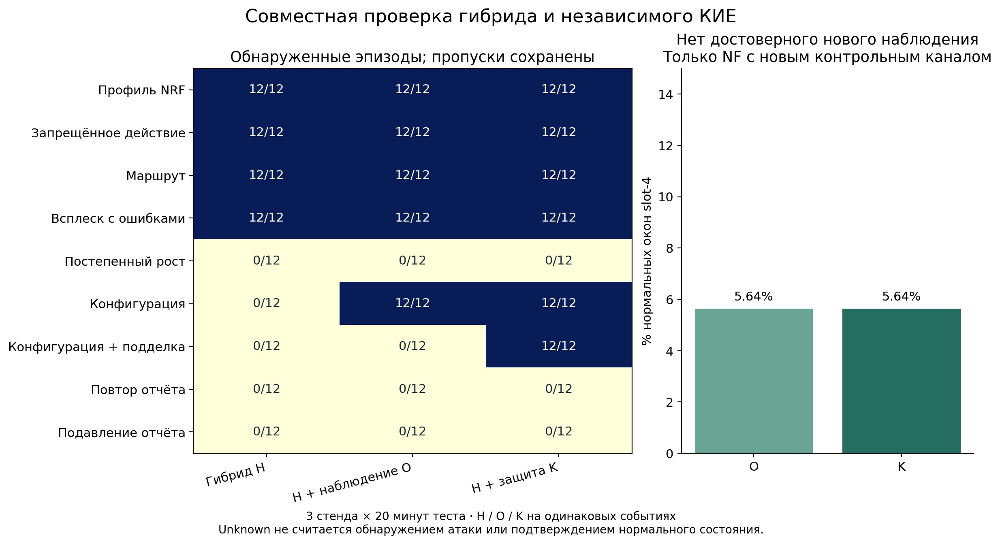

# Совместная проверка гибрида и независимого КИЕ

Эксперимент завершён 8 ноября 2026 года: три отдельных стенда Open5GS 2.7.6,
по 20 минут теста на каждом, восемь логических NF, 108 контролируемых эпизодов
девяти семейств. Обработаны 28 800 тестовых NF-окон: 1 080 атакующих и
27 720 нормальных. Независимое наблюдение и защита отчёта повысили обнаружение,
но не устранили пропуски при потере достоверного контроля и постепенном росте нагрузки.

## Основной результат

H — прежний полный hybrid_tail, заново обученный на нормальной нагрузке этой
серии. O — H с независимым наблюдением фактической конфигурации. K — O с HMAC.
Все три варианта получают одинаковые события, общую замороженную модель и порог.

| Вариант | Обнаружено эпизодов | Обнаружено атакующих окон | Пропущено атакующих окон | Ложные тревоги |
|---|---:|---:|---:|---:|
| H: исходный гибрид | 48/108 | 480/1080 (44,44%) | 600 | 0/27 720 |
| O: независимое наблюдение | 60/108 | 588/1080 (54,44%) | 492 | 0/27 720 |
| K: защищённое наблюдение | 72/108 | 692/1080 (64,07%) | 388 | 0/27 720 |

Добавление наблюдения дало 12 дополнительных обнаруженных эпизодов; проверка
HMAC — ещё 12. Всего K обнаружил на 24 эпизода больше H. На уровне окон вклад
наблюдения — 108 дополнительных обнаружений, защиты отчёта — ещё 104.
Unknown на атаке считается пропуском, а не успешным обнаружением.



## Результаты по условиям

В каждой строке 12 эпизодов, по четыре на стенд. Каждый эпизод длится 10 окон.

| Условие | H | O | K |
|---|---:|---:|---:|
| S1: изменённый профиль NSSF в NRF | 12/12 | 12/12 | 12/12 |
| S2: discovery, запрещённый лабораторной политикой | 12/12 | 12/12 | 12/12 |
| S3: неверный маршрут исследовательского потребителя | 12/12 | 12/12 | 12/12 |
| S4: всплеск запросов с ошибками | 12/12 | 12/12 | 12/12 |
| C: изменение фактически применяемой конфигурации | 0/12 | 12/12 | 12/12 |
| F: изменение конфигурации, подделка отчёта и всплеск | 0/12 | 0/12 | 12/12 |
| R: изменение конфигурации и повтор прежнего отчёта | 0/12 | 0/12 | 0/12 |
| D: изменение конфигурации и подавление доставки отчёта | 0/12 | 0/12 | 0/12 |
| G: постепенный рост нагрузки внутри нормального диапазона | 0/12 | 0/12 | 0/12 |

Семейства S1–S4 сохранили полное обнаружение в заданном режиме. В C варианты
O/K обнаружили 108 из 120 окон, оставшиеся 12 пришлись на отсутствие отчёта.
В F вариант K обнаружил 104 из 120 окон; в остальных 16 отчёт отсутствовал.
Несмотря на эти пропуски отдельных окон, хотя бы одна тревога возникла в каждом
из 12 эпизодов C и F. Недействительный HMAC означает нарушение целостности
контрольного канала; сам по себе он не доказывает компрометацию NF.

В R и D все 240 атакующих окон дали unknown у O/K: отсутствие достоверного
свежего отчёта было замечено, но не классифицировано как подтверждённая атака.
Это следствие заранее выбранной трёхзначной политики. В G все 120 окон пропущены:
односторонний контроль текущих счётчиков не выделил заданный постепенный рост
внутри разрешённого диапазона. Эти три семейства образуют все 36 пропущенных
эпизодов K; после теста пороги не менялись.

## Ложные тревоги и доступность контроля

Новый КИЕ контролирует только slot-4. Для этой NF получено 3 120 нормальных
окон и 480 атакующих. У O/K нет ложных тревог, но 176 нормальных окон
(5,64%) имеют состояние unknown: 96 из-за реальной задержки отчёта и 80 из-за
остановленного процесса наблюдателя. Доля нормальных окон с достоверным новым
контролем — 94,36%. У H новый канал отсутствует; его отсутствие unknown не
является доказательством лучшей осведомлённости о фактической конфигурации.

На атакующих окнах slot-4 вариант K дал 212 тревог и 268 unknown. Таким образом,
публикация одного нулевого FPR скрыла бы существенную потерю наблюдаемости.
Условный FPR среди окон с определённым решением также равен нулю.
По всем NF нормальная экспозиция составляет 7,7 эквивалентных NF-часа
дискретного односекундного наблюдения, для slot-4 — 0,8667 NF-часа; частота
ложных тревог на этот объём — 0. Это не длительность непрерывного контроля
пауз рестартов и не гарантия эксплуатационного FPR.

## Задержки и расходы

Среди обнаруженных эпизодов K медиана времени от начала команды воздействия
до онлайн-решения — 75,35 мс, 95-й перцентиль — 108,83 мс. Для H — 75,03/95,23 мс,
для O — 75,03/106,98 мс. Наборы обнаруженных эпизодов различаются; эти величины
не доказывают, что один метод быстрее другого. Воздействия согласованы с циклом
наблюдения, поэтому задержка при произвольной фазе атаки не установлена.

За тест длительностью 1200,14–1200,19 с сборщик использовал 48,80–90,38
процессорных секунд (примерно 4,07–7,53% одного ядра), пик памяти —
187,86–188,38 МиБ. Расходы ядра Open5GS и отдельных процессов NF/наблюдателя
в эти значения не входят. Медиана транзакции нового контроля по стендам —
0,80–0,97 мс, p95 — 1,02–1,10 мс. Редкие задержки 0,35 с сохраняются в исходных
данных, но не попадают в p95. Все варианты вычислялись совместно: это измеренные
расходы сборщика, а не причинная оценка дополнительной нагрузки от КИЕ или задержки UE.

## Методика и границы вывода

До теста опубликованы [протокол](PROTOCOL_RU.md) и исполняемый код commit
`7d6747adcc673e5758d59e43184e8a815e91ea3a`. На каждом стенде проведены отдельные
обучение (160 окон) и калибровка (200 окон), только на норме, затем тест с новым
seed и регистрациями. Всего 3 840 обучающих и 4 800 калибровочных NF-окон.
Параметры robust_tail, пороги и модели сохранены до тестового сбора.
Основной гибрид использует robust_tail и семантические проверки. Isolation Forest
вычислялся прежним оценщиком как дополнительный вариант, но вклад IF здесь не заявляется.

Нормальный фон включает всплески 12–36 запросов, разрешённые ошибки 404,
смену конфигурации, рестарты, повторные регистрации, задержки и остановки
наблюдателя. Разрешённые изменения заранее согласованы с политикой; гонки её
обновления не проверены. Отдельный процесс читает фактический файл конфигурации,
а HTTP-ответ исследовательской NF подтверждает её применение. Ответ не поступает
детектору как признак. Endpoint этой NF зарегистрирован в настоящем NRF.

Новый наблюдатель не встроен во внутренние структуры штатной NF Open5GS.
Канал отчётов — локальный IPC с явной подменой/подавлением конверта стендом;
сетевой взлом не воспроизводился. HMAC использует общий секрет. ОС, наблюдатель,
ключ и проверяющая сторона доверенные. Радиодоступ, UE/PDU и аппаратная аттестация
не проверялись. Старые ограничения S2/S3 из предыдущей серии сохраняются.

В этой серии реальная штатная задержка отчётов попадала в нормальные окна;
её сочетание с каждым типом атаки не покрыто. Остановки наблюдателя пересекались
с атаками C/F. Три стенда и зависимые окна не дают основания трактовать 28 800 строк
как столько же независимых испытаний или переносить нулевой FPR на операторский трафик.

Вывод: польза независимого наблюдения и HMAC сохранилась в составе гибрида на
проверенных условиях без наблюдаемого роста ложных тревог. Одновременно выявлены
границы: 36/108 эпизодов пропущены, а на норме новой NF 5,64% окон остались без
достоверного контроля. Для дальнейшего развития требуется отдельная обработка
длительной потери контроля и временных тенденций нагрузки с новой проверкой FPR.

## Аудит и воспроизведение

На каждом runner прошли 25 программных тестов. Независимый пересчёт воспроизвёл
параметры статистической ветви, пороги, решения и метрики. Проверены разделение
фаз, отсутствие атак при обучении, замораживание до теста, хеши данных и модели.
После скачивания аудит дополнен проверкой исходных HMAC и фактического применения
воздействий через HTTP-ответ NF; эти дополнительные проверки также прошли во всех
трёх повторах. Дополнение аудита не меняло модели, измерения или решения.

SHA-256 всех трёх ZIP совпал со значениями GitHub. Полные архивы сохранены локально
в `research_5g/integrated_20261108`; на Actions установлен срок хранения 30 дней.
PCAP в этой серии не собирался; сохранены завершённые HTTP-транзакции, контрольные
отчёты, признаки, разметка, модели, онлайн-решения, журналы и снимки служб.

- [Успешный запуск и полные артефакты](https://github.com/verge88/signal_network_sim/actions/runs/42489202574)
- [Сводка со всеми эпизодами](results/summary.json)
- [Контрольные суммы архивов](results/archive_integrity.json)
- [Рисунок PDF](results/integrated_comparison.pdf)

Для повторного расчёта распакуйте каждый архив в одноимённый каталог и выполните:

```bash
python experiments/integrated_5g/audit.py /data/integrated-5g-10101-42489202574
python experiments/integrated_5g/audit.py /data/integrated-5g-10201-42489202574
python experiments/integrated_5g/audit.py /data/integrated-5g-10301-42489202574
python experiments/integrated_5g/summarize.py /data /results
python experiments/integrated_5g/plot_results.py /results
```

Для графика дополнительно нужен matplotlib. Для нового сбора предусмотрен
workflow `.github/workflows/integrated-5g.yml`; старые каталоги результатов
сохраняйте отдельно. Лабораторные ключи одноразовые и предназначены для проверки
артефактов, не для эксплуатации.
