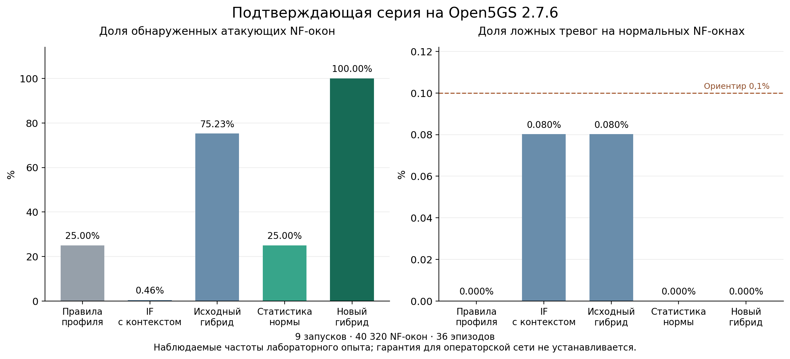

# Проверка метода обнаружения нарушений в лабораторном сегменте 5G

Итоговый отчёт от 8 ноября 2026 года.

В подтверждающей серии новый гибрид обнаружил все 36 контролируемых эпизодов
четырёх семейств на девяти стендах Open5GS 2.7.6. Получены 432 верных обнаружения
на атакующих NF-окнах и ноль ложных тревог на 39 888 нормальных NF-окнах.
Результат положителен для проверенного лабораторного режима. Дополнительная
польза КИЕ относительно тех же проверок без КИЕ в обеих сериях не установлена.

## Выполненная реализация

Стенд собирает Open5GS из commit `d9d3abdd480be96fac3bc8a997e83446648763ca`.
NRF принимает настоящие HTTP/2-запросы регистрации, обновления, discovery и
чтения профилей. Работают штатные функции ядра; одна контролируемая логическая
позиция соответствует настоящей NSSF, остальные — зарегистрированным
исследовательским протокольным клиентам. Масштабы 8, 16 и 32 позиции повторены
по три раза на отдельных GitHub Actions runners.

Реализована цепочка: сетевой запрос → завершённое наблюдение → признаки текущего
окна и истории 10/60 секунд → замороженный детектор → онлайн-решение → отдельное
сопоставление с разметкой. Модели не получают имя сценария, метку атаки или время
команды воздействия. Статистика SBI вычисляется по журналу завершённых запросов
управляемых клиентов; фон штатных NF сохраняется в независимом PCAP.

Наблюдатель отдельно читает профиль NRF и запрашивает отчёт другого процесса
через HTTP. Отчёт защищён HMAC и привязан к nonce и времени. В подтверждающей
серии исследовательский потребитель также выполняет настоящий HTTP-запрос по
выбранному маршруту и сохраняет ответ отдельного процесса получателя.

| Сценарий | Фактически проверенное воздействие |
|---|---|
| S1 | Изменение адресов профиля работающей NSSF настоящим PUT в NRF с проверкой результата отдельным GET |
| S2 | Зарегистрированный программный клиент выполняет discovery, запрещённый заданной лабораторной политикой |
| S3 | Кэш маршрута исследовательского потребителя направляет HTTP-запрос другому получателю при неизменном NRF |
| S4 | Клиент увеличивает число запросов и долю ошибочных ответов |
| N1 | Разрешённые обновления адресов и статусов, перерегистрация, рестарт NSSF, обычная нагрузка и редкие допустимые всплески |

## Разделение данных и развитие метода

В каждом повторе выполнены отдельные нормальные запуски для обучения
(160 окон) и калибровки (200 окон), затем 240 тестовых окон с новыми регистрациями
и seed. Во всей серии — 26 880 обучающих, 33 600 калибровочных и 40 320 тестовых
NF-окон. Окна одного эпизода не разделяются случайно между выборками.
Модель и пороги сохранены с SHA-256 до начала тестового сбора. Онлайн-прогнозы
сверяются с повторным расчётом по сохранённым моделям.

Порог выбирается только по нормальной калибровке: порядковая статистика ранга
`ceil((n + 1) × (1 − 0,001))`, тревога — строгое превышение. Зависимость соседних
окон не позволяет считать этот выбор доказанной гарантией эксплуатационного FPR.

Первая полная серия выявила недостаток исходной статистической ветви:
гибрид обнаружил 27 из 36 эпизодов, пропустив все девять S4. Его TPR составил
75%, FPR — 0,0702%, precision — 92,05%. В отдельных повторах FPR достигал
0,1603%. Эти результаты сохранены, а первая серия рассматривается как основание
для следующей разработки, не как подтверждение исправленной версии.

Затем добавлена отдельная статистическая ветвь `robust_tail`. Она обучает
медиану и MAD текущего числа запросов, доли ошибок и числа обновлений на норме;
минимальные масштабы задаются разрешением соответствующих счётчиков.
Оценка — максимум односторонних нормированных отклонений. Порог независимо
калибруется на нормальных данных. `hybrid_tail` объединяет эту ветвь с проверками
профиля, разрешённых действий, маршрута и контрольного отчёта. Это развитие
состава гибрида; алгоритм Isolation Forest не изменялся.

Подтверждающая серия использовала новые seeds 8101–8901. В нормальный фон всех
частей добавлены редкие разрешённые всплески 8–12 запросов с вероятностью 0,02;
S4 создаёт 24 запроса с ошибками. Все сравниваемые методы получают одни и те же
новые трассы. Идеальное разделение относится к этому ограниченному диапазону
нагрузки и не доказывает обобщение на произвольные интенсивности.

## Результаты подтверждающей серии

| Метод | TPR по NF-окнам | FPR | Precision | AP | Обнаружено эпизодов |
|---|---:|---:|---:|---:|---:|
| Правила профиля | 25,000% | 0% | 100% | 0,2580 | 9/36 |
| IF по SBI | 0,463% | 0,0752% | 6,25% | 0,0664 | 2/36 |
| IF с контекстом | 0,463% | 0,0802% | 5,88% | 0,0610 | 2/36 |
| IF с полным набором | 0,463% | 0,0652% | 7,14% | 0,0577 | 2/36 |
| Исходный гибрид | 75,231% | 0,0802% | 91,04% | 0,8509 | 28/36 |
| Исходный гибрид без КИЕ | 75,231% | 0,0802% | 91,04% | 0,8509 | 28/36 |
| Статистическая ветвь robust_tail | 25,000% | 0% | 100% | 0,2622 | 9/36 |
| Новый гибрид hybrid_tail | 100,000% | 0% | 100% | 1,0000 | 36/36 |
| Новый гибрид без КИЕ | 100,000% | 0% | 100% | 1,0000 | 36/36 |

AP означает average precision. Для вариантов с независимо обученными моделями
объединённая AP описательна: в машинной сводке дополнительно приведены AP каждого
повтора и их среднее. Доля атакующих окон составляет 1,0714%; precision зависит
от этой доли.

Новый гибрид обнаружил каждое семейство в каждом из девяти повторов. Пропущенных
эпизодов нет; запусков с ложными тревогами — 0/9, частота ложных тревог на
наблюдавшийся NF-час — 0. Медиана времени от начала команды воздействия до
первой онлайн-тревоги — 96,92 мс, 95-й перцентиль — 165,24 мс. Начало воздействия согласовано с циклом наблюдения,
поэтому эти значения не характеризуют задержку при произвольной фазе атаки.
Это уточнение протокола: отсчёт начинается перед командой воздействия и включает
время её выполнения, а не начинается с первого подтверждённого вредоносного события.

## Измеренные расходы мониторинга

За тестовый сбор длительностью около 240 секунд процесс сборщика использовал
10,77–35,00 процессорных секунд, то есть в среднем 4,49–14,58% одного ядра.
Пиковая резидентная память составила 168,48–170,62 МиБ. Это расходы сборщика,
не сумма потребления ядра Open5GS и всех вспомогательных процессов.

Обмен наблюдателя с NRF и процессом контрольных отчётов составил примерно
2,08 / 4,08 / 8,09 МБ прикладных данных при 8 / 16 / 32 позициях соответственно.
В эти значения не входят сетевые заголовки и весь фоновый обмен ядра.

Отдельный парный опыт включал восемь блоков по 30 запросов в каждом из двух
режимов: мониторинг включён и выключен, порядок случайный. Всего выполнено
4 320 запросов на девяти стендах; ошибок запросов и контрольных проверок нет.
Медиана парных разностей p50 длительности полного последовательного цикла
составила 1,18–2,94 мс по повторам. Этот цикл включает блокирующие обращения
наблюдателя и не является задержкой абонентской процедуры 5G.
Показатели каждого повтора приведены в [аудите](results/AUDIT_V2.md).

## Что подтверждено и что осталось ограничением

Подтверждены работа сетевого прототипа, причинное формирование признаков,
воспроизводимость решений и взаимодополнение семантического контроля и обучаемой
статистической ветви на четырёх заданных воздействиях. Дополнительная ветвь
устранила пропуски S4 на новой серии. Утверждать, что этот результат получен
благодаря обучению Isolation Forest, нельзя.

Удаление КИЕ не изменило итоговых решений. В данном прототипе контрольный
процесс подписывает нормативный профиль, а его расхождение с NRF дублирует
проверку политики. Подпись подтверждает источник и целостность отчёта в пределах
доверия к ключу, но не аппаратную аттестацию Open5GS и не правдивость
скомпрометированного источника. Гипотеза об отдельном приросте обнаружимости от
КИЕ этой серией не подтверждена.

Нулевая наблюдаемая частота ложных тревог не является гарантией FPR ≤ 0,1% в
эксплуатации: окна зависимы, сценарии известны, нормальная нагрузка ограничена.
Число независимых запусков равно девяти, а число эпизодов — 36; 40 320 строк
не считаются таким же числом независимых испытаний.

Во время рестарта NSSF сборщик ждёт восстановления регистрации. Проверена
согласованность после рестарта, но не непрерывное обнаружение во время простоя.
S2 означает нарушение специально заданной политики; сам запрос AMF к UDM не
объявляется атакой по 3GPP. S3 относится к исследовательскому HTTP-потребителю,
а не к эксплуатации уязвимости настоящей AUSF. Радиодоступ, абонентская
регистрация, PDU-сеансы и операторский трафик не проверялись.

## Воспроизводимость и диагностические отклонения

Исполняемый код подтверждающей серии закреплён commit
`da0cf745c05f38c83fd412dec6b6c3c36873cea4`. Исходные события, разметка, признаки,
модели, онлайн-прогнозы, журналы, конфигурации и расходы сохранены в артефактах
Actions и локальной папке `research_5g/live_20261107`.

В упаковке диагностики обнаружены два дефекта: `service_status.txt` пуст из-за
неверного вызова systemctl; исходный хеш PCAP не совпал во всех девяти повторах.
Наиболее вероятная причина — отсутствие ожидания завершения захвата; она не
доказана по временным меткам. Исторические SHA256SUMS для PCAP не считаются
успешно проверенными. При этом SHA-256 всех десяти окончательных ZIP-архивов
(девять повторов и сводный отчёт) совпал со значениями GitHub; все девять PCAP
имеют полную структуру записей без обрыва последнего пакета. Это подтверждает
целостность скачанных архивов, но не полноту захвата всего сетевого обмена.
Численные данные и модели проверены отдельно: все проверки обучения,
калибровки, онлайн-решений и метрик прошли во всех девяти повторах.
Порядок закрытия захвата и команда снимка служб исправлены для будущих запусков;
эта правка не изменяет исторические измерения и ещё не проверена новым стендовым
запуском. Итоговая локальная проверка кода: 23 теста пройдены.

Первый технический запуск завершился отказом NRF на масштабе 32 из-за стандартного
пула клиентов. Параметр `global.max.peer` увеличен до 512 до полной серии.
Неудачный запуск сохранён.

## Материалы

- [Технический запуск и отказ ёмкости](https://github.com/verge88/signal_network_sim/actions/runs/42368230358)
- [Первая полная серия](https://github.com/verge88/signal_network_sim/actions/runs/42368716451)
- [Подтверждающая серия](https://github.com/verge88/signal_network_sim/actions/runs/42395496419)
- [Код измеренной версии](https://github.com/verge88/signal_network_sim/tree/da0cf745c05f38c83fd412dec6b6c3c36873cea4/experiments/live_5g)
- [Протокол](PROTOCOL_RU.md), [сводные показатели](results/confirmation_summary.json), [независимый аудит](results/AUDIT_V2.md)
- [Проверка архивов](results/archive_integrity.json), [исходная серия](results/initial_summary.json), [рисунок PDF](results/ablation_v2.pdf)
- [3GPP TS 29.510](https://www.etsi.org/deliver/etsi_ts/129500_129599/129510/18.11.00_60/ts_129510v181100p.pdf), [официальная сборка Open5GS](https://open5gs.org/open5gs/docs/guide/02-building-open5gs-from-sources/)
