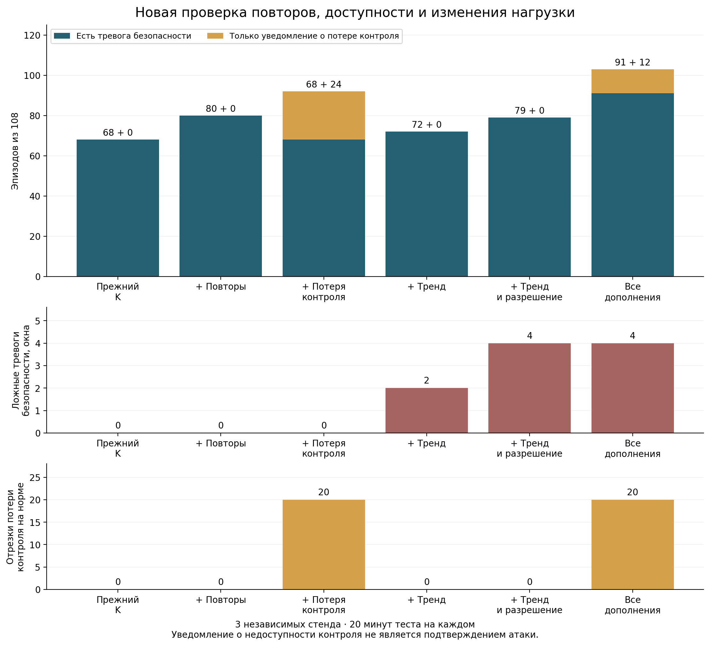

# Проверка обработки повторов, потери контроля и роста нагрузки

Серия 8 ноября 2026 года на трёх независимых runner GitHub Actions завершена.
На одних и тех же новых данных прежний вариант K дал тревогу безопасности в
68/108 эпизодов, совместный KALL — в 91/108. Ещё 12 эпизодов подавления доставки
вызвали только уведомление о потере контроля. Операционное покрытие — 103/108;
это не обнаружение 103 атак. Получены 4 ложные тревоги безопасности на 27 720
нормальных NF-окнах. Все результаты, включая пропуски, сохранены.

Из трёх ранее пропускавшихся семейств: R — 12/12 тревог безопасности;
G — 11/12; D — 12/12 уведомлений о недоступности без подтверждения атаки.
Остался один G и выявлена нестабильность прежней калибровки: четыре S4 на одном
стенде полностью пропущены всеми вариантами.



## Что проверялось

До измерений опубликованы [протокол](PROTOCOL_RU.md), код и workflow в commit
`42c14bd214dc288decd0d74031b6963ffb4dfdd4`.
[Запуск 42509270381](https://github.com/verge88/signal_network_sim/actions/runs/42509270381)
содержит три завершившихся успешно задания, seeds 21101, 21201, 21301.
На каждом стенде: 8 логических NF-позиций, 240 нормальных окон обучения,
240 независимой нормальной калибровки и 1200 тестовых окон с периодом 1 с.
Итого 5760 обучающих, 5760 калибровочных и 28 800 тестовых NF-окон;
108 эпизодов по 10 окон, 1080 атакующих и 27 720 нормальных окон теста.

Использованы настоящий Open5GS NRF, штатная NSSF, HTTP/2-взаимодействия и
программные NF-участники. Отдельный наблюдатель читает применённый файл
конфигурации исследовательской NF slot-4; независимый HTTP-ответ подтверждает
её поведение. Внутренняя память штатных NF Open5GS, радиодоступ и UE/PDU здесь
не проверялись. Это проверка метода на стенде компонентов 5G, а не полная
эксплуатационная валидация сети оператора.

Реализованы три дополнения: аутентифицированные session/sequence и учёт
обработанных отчётов; уведомление при длительном отсутствии свежего отчёта;
накопление признака устойчивого роста числа запросов. Для последнего отдельно
проверены чистая статистика T и вариант P, учитывающий предварительное
разрешение оператора на рост нагрузки. Разрешение ограничено NF, временем и
числом запросов и защищено отдельным HMAC. Это дополнительный доверенный
контекст. Он не является результатом обучения статистического детектора.

Порог отсутствия свежего отчёта во всех трёх повторах — 6 с. Пороги T —
14, 12, 14; P — 1, 1, 1. Они определены только по новой норме и зафиксированы
до теста. Решение принимается при строгом превышении порога. Временной признак
выбран после анализа прошлых пропусков; он не претендует на универсальное
обнаружение всех медленных атак.

## Сравнение на общих тестовых событиях

Каждое дополнение сравнивается с K, остальные дополнения отключены.
KALL включает проверку повторов, доступность и P.

| Вариант | Эпизоды с тревогой безопасности /108 | Эпизоды с любым уведомлением /108 | Атакующие окна с тревогой /1080 | Ложные тревоги /27720 нормальных окон |
|---|---:|---:|---:|---:|
| K: прежний защищённый гибрид | 68 | 68 | 664 | 0 |
| KR: K + повторы | 80 | 80 | 764 | 0 |
| KA: K + потеря контроля | 68 | 92 | 664 | 0 |
| KT: K + чистый временной признак | 72 | 72 | 672 | 2 |
| KP: K + временной признак и разрешение | 79 | 79 | 706 | 4 |
| KALL: все дополнения | 91 | 103 | 806 | 4 |

KALL: полнота по эпизодам тревог безопасности 84,26%; по атакующим окнам
74,63%; FPR по нормальным окнам 0,01443%. Сумма тревог и уведомлений покрыла
95,37% эпизодов и 890/1080 атакующих окон. Совместную метрику нельзя называть
полнотой обнаружения атак. Нормальная экспозиция — 7,7 эквивалентных NF-часа
односекундных выборок, 0,519 ложной тревоги безопасности на такой NF-час.
Это не оценка частоты ложных тревог в операторской сети.

| Семейство | K: эпизоды с тревогой | KALL: эпизоды с тревогой | KALL: эпизоды с любым уведомлением |
|---|---:|---:|---:|
| S1 | 12/12 | 12/12 | 12/12 |
| S2 | 12/12 | 12/12 | 12/12 |
| S3 | 12/12 | 12/12 | 12/12 |
| S4 | 8/12 | 8/12 | 8/12 |
| C: изменение фактической конфигурации | 12/12 | 12/12 | 12/12 |
| F: подделка отчёта | 12/12 | 12/12 | 12/12 |
| R: повтор захваченного отчёта | 0/12 | 12/12 | 12/12 |
| D: подавление доставки | 0/12 | 0/12 | 12/12 |
| G: постепенный рост нагрузки | 0/12 | 11/12 | 11/12 |

## Пропуски, ложные тревоги и потеря наблюдаемости

Пропущенный G — `test-21321-G-185`, шаг роста 1 запрос за окно. Первые пять
окон совпали с действующим разрешением оператора и сбросили накопитель P.
После окончания разрешения максимум P достиг 1, равного порогу: тревоги нет.
Ещё пять G с пересечением разрешения обнаружены лишь примерно через 9 с.
Разрешение на допустимую суммарную нагрузку может скрывать нежелательную
активность внутри этого допуска; различение требует дополнительных признаков.

Все четыре пропуска S4 относятся к seed 21301. Оценка S4 равна 11,84,
но общий порог robust_tail — 14,613966. Его подняли нормальные всплески до 37
запросов при масштабе признака количества запросов 2,2239. На двух других
стендах S4 обнаружены. Это проблема единого порога для максимума разных
стандартизованных признаков: вариация нагрузки маскирует аномальную долю ошибок.
Порог после просмотра теста не менялся. [Диагностика](results/diagnostics.json)
содержит параметры, калибровочные экстремумы и историю каждого ложного решения.

Четыре ложных тревоги KP/KALL вызваны случайными нормальными рядами 1,2,3,4,5,6
или 2,3,4,5,6,7: P=2 превышает нормальный калибровочный порог 1. Это окна
21101/279/slot-0 и 21301/91/slot-5, 639/slot-4, 717/slot-3. Две тревоги KT
возникли при продолжении разрешённого роста обычным всплеском. Никакие такие
окна не исключались. Проверка повторов KR новых ложных тревог не дала.

Уведомления о потере контроля появились на 45 нормальных окнах slot-4
(1,44% от 3120), объединённых в 20 непрерывных нормальных отрезков. Из них
12 относятся к запланированным длительным штатным остановкам наблюдателя,
8 являются продолжением недоступности после атакующих интервалов. Поэтому
20 — число нормальных отрезков, а не число отдельных штатных отказов.
Уведомления правильно показывают отсутствие свежего контроля, но не доказывают
злонамеренную причину. Совместно с четырьмя ложными тревогами KALL даёт
49 нормальных окон с каким-либо уведомлением.

Базовое состояние unknown на норме slot-4 сохраняется в 264/3120 окон (8,46%).
Перевод 45 из них в уведомление о недоступности не восстанавливает достоверный
контроль. В итоговом состоянии KALL остаются 219 нормальных unknown (7,02%)
и 72 атакующих unknown. Публиковать только FPR без этой потери наблюдаемости
было бы недостаточно.

## Время реакции и расходы

Для обнаруженных R медиана/95-й перцентиль задержки — 73,12/84,70 мс.
Для G среди 11 обнаруженных — 5,059/9,100 с. Для D измерено время до
уведомления, а не обнаружения атаки: 5,100/6,098 с. Порог 6 с отсчитывается
от последнего свежего отчёта, а задержка — от начала воздействия; поэтому
она может быть меньше 6 с. Общая медиана задержки тревог KALL — 73,69 мс,
p95 — 7,065 с. Состав обнаруженных эпизодов различается, и общая медиана
не характеризует реакцию на медленный рост. Воздействия привязаны к циклу
наблюдения; произвольная фаза начала атаки не проверена.

Тест каждого стенда длился 1200,15–1200,76 с. Сборщик использовал
67,26–90,17 процессорных секунд, около 5,60–7,51% одного ядра; пик памяти
188,05–189,80 МиБ. Медианы контрольной транзакции — 0,873–0,963 мс,
p95 — 0,972–1,085 мс. Редкие искусственные задержки 0,35 с сохранены в данных,
но не отражаются в p95. Все варианты вычислялись совместно. Эти расходы
не включают все процессы Open5GS/NF и не оценивают причинно добавочную
стоимость каждого дополнения или задержку UE.

## Ограничения и дальнейшая проверка

В новой серии изменены нормальный фон и некоторые воздействия: добавлены
разрешённые рампы и длинные штатные остановки; G имеет шаг 1/2/3; R повторяет
один захваченный отчёт. Поэтому сравнение 68→91 допустимо внутри этой серии,
а изменение относительно прежних 72/108 нельзя целиком приписывать алгоритму.

ОС, наблюдатель, HMAC-ключи и канал выдачи разрешений доверенные. Проверка
повтора фиксирует нарушение протокола, а не доказывает компрометацию NF.
Допустимые идемпотентные повторы требуют другой политики. Реальная
межзапросная перестановка отчётов проверена программным тестом; в живой серии
использованы задержки внутри текущего запроса. Сбой доставки вводился в
локальный IPC-конверт; сетевой взлом не воспроизводился. Таймер оценивается
при очередном наблюдении и не является независимым сторожевым процессом
на случай остановки самого сборщика.

Три стенда и зависимые окна не дают основания трактовать все строки как
независимые испытания или обещать эксплуатационный FPR. Чистый T выявил
только 4/12 G; более сильный результат P зависит от доверенного разрешения.
Неучтённый законный рост может быть неотличим от нежелательного.

Следующая проверяемая доработка — раздельная калибровка статистических
признаков с общим контролем ложных тревог, более длинная нормальная калибровка
временной ветви и явная проверка роста внутри разрешённого диапазона.
Эти идеи возникли после данной серии и пока не подтверждены новыми измерениями.
В текущие результаты они не включены.

## Аудит и воспроизведение

На каждом runner прошли 29 программных тестов; те же 29 прошли локально.
Независимый аудит всех трёх архивов воспроизвёл модель, пороги, исходные
решения и новые временные/протокольные решения, проверил полные сетки окон,
разделение фаз, отсутствие атак в обучении/калибровке, замораживание до теста,
хеши и фактическое применение воздействий. После теста добавлены только
диагностика, отчётность и дополнительные проверки аудита; измеренный
детектор и исходные решения не менялись.

SHA-256 всех трёх ZIP совпадает с GitHub. Полные архивы сохранены локально
в `research_5g/resilient_20261108`, в Actions срок хранения — 30 дней,
до 8 декабря 2026 года. В репозитории постоянно сохранены сводки, диагностика,
контрольные суммы и рисунки. Полные ZIP не включены в Git. PCAP не собирался;
сохранены HTTP-транзакции, отчёты, разрешения, признаки, разметка, модели,
решения, журналы и состояние служб. Лабораторные ключи одноразовые.

- [Все эпизоды и метрики](results/summary.json)
- [Диагностика ошибок](results/diagnostics.json)
- [Контрольные суммы архивов](results/archive_integrity.json)
- [Рисунок PDF](results/comparison.pdf), [SVG](results/comparison.svg)

После распаковки архивов в одноимённые каталоги:

```bash
python -m experiments.resilient_5g.audit /data/resilient-5g-21101-42509270381
python -m experiments.resilient_5g.audit /data/resilient-5g-21201-42509270381
python -m experiments.resilient_5g.audit /data/resilient-5g-21301-42509270381
python experiments/resilient_5g/summarize.py /data /results
python -m experiments.resilient_5g.diagnose /data /results
python experiments/resilient_5g/plot_results.py /results
```

Зависимости сбора и аудита — `experiments/live_5g/requirements.txt`;
для графика дополнительно требуется matplotlib. Новый сбор запускается
workflow `.github/workflows/resilient-5g.yml`.
