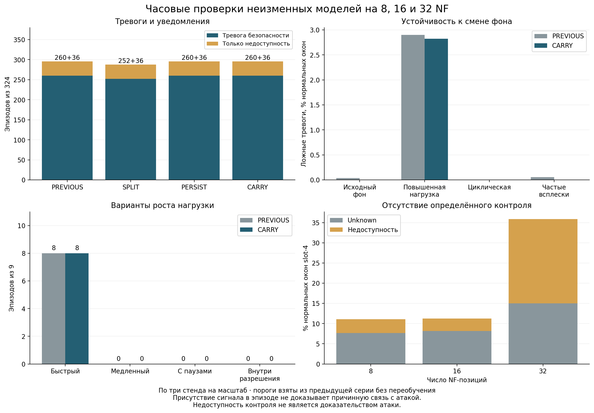

# Часовая проверка замороженного метода на 8, 16 и 32 NF

В девяти новых прогонах CARRY имел тревогу безопасности в 260 из 324 эпизодов; ещё в 36 эпизодах присутствовало только уведомление о недоступности контроля. Без обоих сигналов осталось 28 эпизодов. На нормальных данных зарегистрировано 4246 ложных окон из 600570 (0.7070%). Устойчивость к произвольной смене фона и форме роста нагрузки не подтверждена.

[Запуск 42617081721](https://github.com/verge88/signal_network_sim/actions/runs/42617081721) · исходный код измерений `4338a47bee8f9d0c369e2003d68ec4c5ad625d9d` · [предварительный протокол](PROTOCOL_RU.md).

## Постановка и проверка

Три ранее зафиксированные модели из запуска 42577623990 проверены каждая на 8, 16 и 32 логических NF-позициях. Новых обучения, калибровки или подбора порогов по этим тестам нет. В каждом прогоне 3600 окон и 36 воздействий; всего 604800 NF-окон, включая 4230 атакующих и 600570 нормальных. Четыре последовательных фоновых режима занимают по 900 окон. Это девять отдельных runner и три исходные модели, а не девять независимых операторских сетей.

Во всех девяти заданиях прошли 40 программных тестов. Все девять ZIP проверены по опубликованному GitHub SHA-256. Локально повторены независимые расчёты непосредственно из ZIP: проверка исходных файлов, замороженных моделей, разделения выборок, фактических воздействий, полного набора наблюдений, подписей и решений. Итоговые метрики, эпизоды и проверки совпали с CI; список расхождений решений пуст. Успех workflow означает целостность эксперимента, а не достижение желаемой точности.

## Сравнение вариантов

PREVIOUS — ранее реализованный KALL; SPLIT — отдельные пороги количества запросов, ошибок и обновлений; PERSIST — дополнительное подтверждение тренда; CARRY — сохранение истории тренда при временном разрешении нагрузки. Все варианты вычислены на одних исходных событиях.

| Метод | Безопасность, эпизоды / 324 | Только недоступность | Без сигнала | TP / 4230 окон | Ложные окна / 600570 | FPR | Отрезки ложных тревог |
|---|---:|---:|---:|---:|---:|---:|---:|
| PREVIOUS | 260 | 36 | 28 | 2540 | 4490 | 0.7476% | 4361 |
| SPLIT | 252 | 36 | 36 | 2488 | 4221 | 0.7028% | 4110 |
| PERSIST | 260 | 36 | 28 | 2524 | 4224 | 0.7033% | 4112 |
| CARRY | 260 | 36 | 28 | 2534 | 4246 | 0.7070% | 4133 |

Обнаружение эпизода означает хотя бы одну тревогу внутри его интервала. Оно не означает обнаружение каждого атакующего окна. Уведомление о недоступности само по себе не доказывает атаку; такие уведомления бывают и при штатных остановках наблюдателя.

## Результаты CARRY по сценариям

| Сценарий | Эпизодов | Тревога безопасности | Любой из двух сигналов |
|---|---:|---:|---:|
| C | 36 | 35 | 36 |
| D | 36 | 1 | 36 |
| F | 36 | 36 | 36 |
| G | 36 | 8 | 8 |
| R | 36 | 36 | 36 |
| S1 | 36 | 36 | 36 |
| S2 | 36 | 36 | 36 |
| S3 | 36 | 36 | 36 |
| S4 | 36 | 36 | 36 |

S1 — изменение профиля NSSF в NRF; S2 — discovery запрещённого политикой типа NF; S3 — изменение маршрута исследовательского потребителя; S4 — серия ошибочных запросов. C — изменение контролируемой конфигурации; F — подделка контрольного отчёта; R — повтор старого отчёта; D — подавление доставки; G — рост нагрузки. Точные воздействия заданы в исходном коде и протоколах соответствующих серий.

| Форма G | Эпизодов | Тревога безопасности |
|---|---:|---:|
| fast | 9 | 8 |
| slow | 9 | 0 |
| intermittent | 9 | 0 |
| inside_permit | 9 | 0 |

| Сценарий CARRY | Эпизодов с измеренной задержкой безопасности | Медиана, с | p95, с |
|---|---:|---:|---:|
| C | 35 | 0.1267 | 0.5515 |
| D | 1 | 5.2678 | 5.2678 |
| F | 36 | 0.1351 | 0.3048 |
| G | 8 | 4.2382 | 5.1703 |
| R | 36 | 0.1359 | 0.2844 |
| S1 | 36 | 0.1187 | 0.3143 |
| S2 | 36 | 0.1549 | 0.3655 |
| S3 | 36 | 0.1461 | 0.3135 |
| S4 | 36 | 0.1462 | 0.3798 |

Для D медиана задержки любого уведомления — 5.2064 с, p95 — 6.1692 с. Это уведомления о доступности, а не подтверждение атаки. Задержки пропущенных эпизодов не приравниваются к нулю.

## Проверка причин отдельных результатов

Единственная тревога безопасности в D (`test-44233-nf32-D-960`) возникла в окне 965: обычная фоновая нагрузка составила 42 запроса при пороге 37. Доставка отчёта была подавлена, семантический и временной признаки не сработали. Эта тревога совпала с эпизодом, но не доказывает распознавание самого подавления. Первичная метрика 260/324 сохранена по заранее заданному правилу совпадения во времени; причинно приписывать все 260 тревог соответствующим атакам нельзя.

Один C (`test-44133-nf32-C-1140`) не дал тревоги безопасности: во всех десяти окнах доставленный отчёт имел возраст 279–380 мс, превышающий предел 250 мс. Уведомление о недоступности уже действовало до начала воздействия. Один fast G (`test-44309-nf8-G-1560`) полностью пришёлся на действующее разрешение — 10 из 10 окон. Все девять специально запланированных inside_permit также имели действующее разрешение во всех 20 окнах.

На предыдущем окне уведомление о недоступности уже было активно перед 10 эпизодами: 3 C, 4 D, 2 F и 1 R. Поэтому совместное покрытие 296/324 означает присутствие сигнала в интервале, а не 296 новых уведомлений, причинно вызванных воздействиями. Исходные состояния границ опубликованы в diagnostics.json; измерения трёх разобранных случаев — в [case_review.json](results/case_review.json).

Причина пропусков медленного и прерывистого роста согласуется с кодом: `Trend` требует последовательных положительных приращений, а повтор значения или снижение сбрасывают накопление. При действующем разрешении выход тренда подавляется. По одинаковым наблюдаемым данным разрешённую и нежелательную активность внутри одного разрешения различить нельзя.

Для каждого эпизода опубликовано фактическое число окон с разрешением (`permitted_windows`). Оно относится к измеренной нагрузке и времени, а не только к плановому расписанию.

## Смена нормального фона

| Режим | Нормальных окон | Ложные окна PREVIOUS | Ложные окна CARRY | FPR CARRY |
|---|---:|---:|---:|---:|
| reference | 149700 | 53 | 1 | 0.0007% |
| higher_load | 150240 | 4358 | 4242 | 2.8235% |
| cyclic | 150390 | 0 | 0 | 0.0000% |
| bursty_recovery | 150240 | 79 | 3 | 0.0020% |

В режиме higher_load законные всплески достигают 48 запросов плюс heartbeat при замороженном пороге количества 37. Их тревоги учитываются как ложные. Номинальный уровень калибровки не является гарантией FPR после смены распределения. Сравнение сценариев между режимами также зависит от их расписания; чистая причинная оценка влияния фона на recall здесь не заявляется.

## Масштаб и свежесть контроля

| NF | Безопасность / 108 эпизодов | Любой сигнал / 108 | Ложные окна | FPR | Unknown на нормальном slot-4 | Недоступность на нормальном slot-4 |
|---|---:|---:|---:|---:|---:|---:|
| 8 | 86 | 98 | 569 | 0.6695% | 793/10320 | 353/10320 |
| 16 | 87 | 99 | 1167 | 0.6809% | 841/10320 | 319/10320 |
| 32 | 87 | 99 | 2510 | 0.7292% | 1549/10320 | 2156/10320 |

| NF | Исходная модель (seed) | p95 возраста отчёта, мс | Нормальных отчётов старше 250 мс | Из них устарели после возврата контрольного вызова |
|---|---:|---:|---:|---:|
| 8 | 33101 | 78.90 | 96 | 0 |
| 8 | 33201 | 55.67 | 96 | 0 |
| 8 | 33301 | 37.89 | 96 | 0 |
| 16 | 33101 | 104.45 | 100 | 4 |
| 16 | 33201 | 200.46 | 104 | 8 |
| 16 | 33301 | 171.38 | 97 | 1 |
| 32 | 33101 | 432.43 | 1587 | 1491 |
| 32 | 33201 | 307.16 | 464 | 368 |
| 32 | 33301 | 343.66 | 805 | 709 |

Возраст измерен в момент решения по всем нормальным окнам slot-4, где исходный отчёт существует. Отсутствующие отчёты и заранее внесённые штатные задержки учтены отдельно в diagnostics.json. Сборщик получает отчёт до окончания обработки всех NF; поэтому рост ожидания до решения может нарушать фиксированную границу свежести 250 мс. Это ограничение текущей организации сбора, а не измеренная предельная производительность Open5GS или сети 5G.

## Длительность и расходы

| NF | Seed | Длительность, с | Интервал p50 / p95, с | CPU сборщика, с | Пиковый RSS, MiB |
|---|---:|---:|---:|---:|---:|
| 8 | 33101 | 3600.48 | 1.0002 / 1.0262 | 340.73 | 244.1 |
| 8 | 33201 | 3600.39 | 1.0001 / 1.0204 | 244.04 | 244.1 |
| 8 | 33301 | 3600.31 | 1.0001 / 1.0130 | 159.77 | 244.0 |
| 16 | 33101 | 3600.38 | 1.0002 / 1.0229 | 293.55 | 264.7 |
| 16 | 33201 | 3602.78 | 1.0002 / 1.0394 | 588.45 | 263.5 |
| 16 | 33301 | 3600.51 | 1.0002 / 1.0357 | 496.33 | 265.0 |
| 32 | 33101 | 3609.61 | 1.0002 / 1.0605 | 1066.46 | 310.3 |
| 32 | 33201 | 3600.42 | 1.0002 / 1.0445 | 751.79 | 310.2 |
| 32 | 33301 | 3600.85 | 1.0001 / 1.0522 | 827.06 | 309.7 |

CPU и RSS относятся к процессу сборщика, а не к сумме всех процессов стенда. NF-окна / 3600 дают только эквивалент выборочного наблюдения. Наблюдения во времени зависимы, а модели повторно используются по масштабам; биномиальные интервалы по всем окнам как по независимым наблюдениям не приводятся.

## Что подтверждено и что требуется дальше

Проверка расширяет предыдущий короткий эксперимент: показывает воспроизводимость при большем числе позиций и одновременно выявляет переносимость порогов, формы роста и задержку сбора как нерешённые ограничения. Ранее полученное обнаружение всех коротких эпизодов нельзя переносить на эти новые воздействия.

Следующая разработка должна отдельно проверить: (1) получение и проверку контрольного отчёта без ожидания остальных NF, сохраняя защиту от повтора и предел свежести; (2) признаки медленного и прерывистого роста, калибруемые на законных плато и циклах; (3) явно заданные рабочие режимы нагрузки и разрешения, чтобы высокий законный фон не выходил за область калибровки. Настройка потребует новых обучающих и калибровочных данных, затем новых независимых тестов. Текущую серию следует сохранить как уже просмотренный диагностический набор.

Стенд содержит реальный NRF и штатную NSSF Open5GS, исследовательскую NF и программные клиенты. Число логических позиций не равно числу полноценных нативных 5G-функций. Здесь нет сквозной проверки радиодоступа, UE/PDU-сессий, аппаратной аттестации или компрометации доверенных ОС/наблюдателя/ключей. Полная эксплуатационная валидация метода на операторской сети ещё не выполнена.

## Материалы и воспроизведение



- [Общая сводка и все эпизоды](results/summary.json)
- [Диагностика задержек и ложных тревог](results/diagnostics.json)
- [SHA-256 архивов](results/archive_integrity.json)
- [Выдержки CI: тесты и независимый аудит](results/ci_audit_logs.json)
- [График PDF](results/comparison.pdf) · [SVG](results/comparison.svg)

В results также сохранены девять отдельных файлов `*-audit.json`. Исходные ZIP сохранены локально и доступны как артефакты указанного запуска в пределах срока хранения Actions (30 дней). Лабораторные ключи в них служат только воспроизведению эксперимента.

После скачивания ZIP повторный аудит выполняется без распаковки:

```text
python -m experiments.robustness_5g.audit_archive PATH_TO_ARCHIVE.zip
python -m experiments.robustness_5g.summarize ARCHIVE_DIRECTORY experiments/robustness_5g/results
python -m experiments.robustness_5g.diagnose ARCHIVE_DIRECTORY experiments/robustness_5g/results
python -m experiments.robustness_5g.case_review ARCHIVE_DIRECTORY experiments/robustness_5g/results
python -m experiments.robustness_5g.plot_results experiments/robustness_5g/results
python -m experiments.robustness_5g.report
```

Адаптер ZIP записывает только производные сводки рядом с архивом. Код детекторов и измерений в этой публикации результатов не изменяется.
